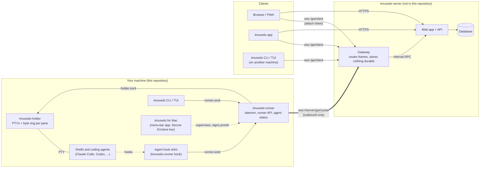
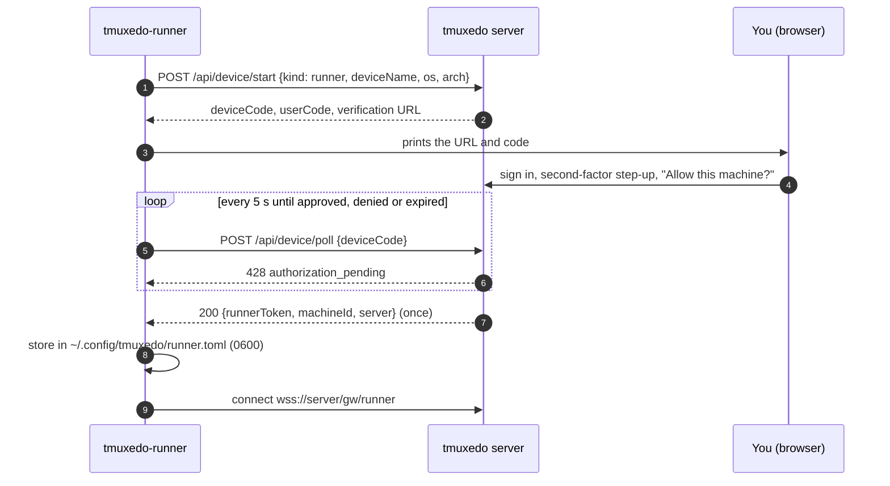
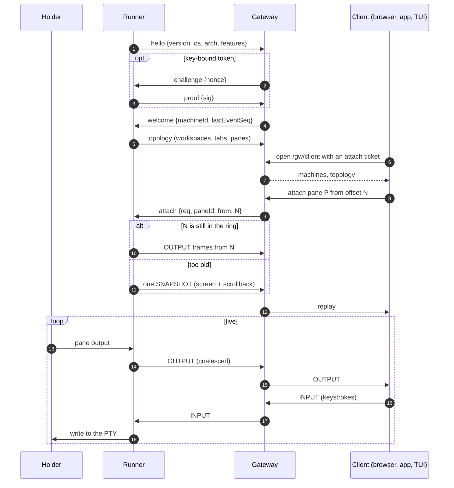
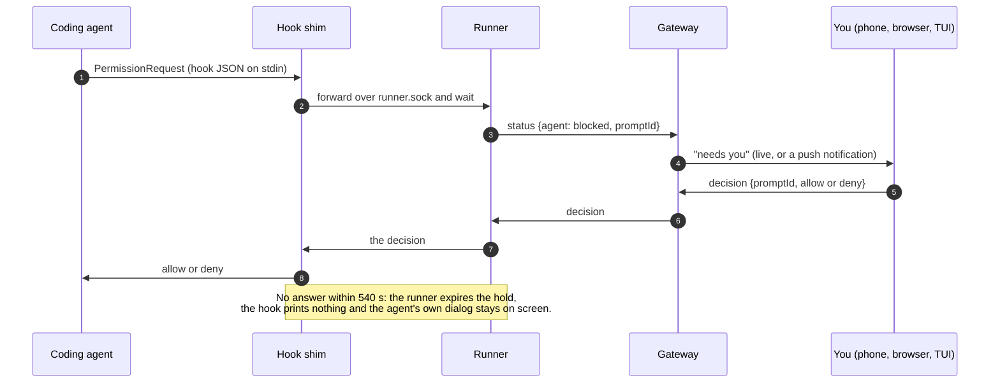
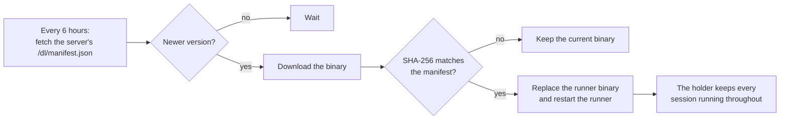

# tmuxedo runner

The machine-side half of [tmuxedo](https://tmuxedo.dev): terminals and coding agents (Claude Code and
others) on your own machines, reachable from a browser, the tmuxedo app or this repository's CLI, without
opening any inbound port.

This repository holds everything that runs **on your machine**, plus the wire contract it speaks:

| Path | What it is |
|---|---|
| `runner/crates/holder` | The PTY holder: owns the terminal processes and a byte ring per pane, so the runner can restart or update without ending your sessions. Runs as its own user service. |
| `runner/crates/runner` | `tmuxedo-runner`: the daemon that dials **out** to a tmuxedo server over a WebSocket, the runner API (a unix socket; `runner/api/runner-api.schema.json`), agent status (Claude Code hooks, screen detection), enrolment, self-update, the memory watchdog, the `tmuxedo` CLI and terminal UI, and the agent hook shim. One binary. |
| `runner/crates/emu` | Terminal emulation and snapshots (on `vt100`). |
| `runner/crates/protocol` | The relay protocol's binary data frames, in Rust. |
| `runner/crates/detect` | Which coding agent runs in a pane (from the process table) and whether it is working, blocked or idle (from the screen), for 24 agents; specified in `docs/design/agent-detection.md`. |
| `runner/crates/runner/plugins` | Built-in agent plugin manifests (Claude Code) and their conformance tests. |
| `packages/protocol` | The same wire contract in TypeScript (`@tmuxedo/protocol`): frames, attach tickets, runner tokens, glances, the login callback relay, with **golden fixtures** in `packages/protocol/fixtures/` that both the Rust and the TypeScript tests check. |
| `docs/protocol.md` | The relay protocol v1 specification that the code and fixtures implement (runner, gateway and client sides). |
| `apps/mac` | **tmuxedo for Mac**: the menu-bar app that bundles and supervises the runner, pairs the Mac with a key in its Secure Enclave, and can run your terminals as a separate, locked-down macOS user. See [apps/mac/README.md](apps/mac/README.md). |

The server side (web app, gateway, database) is not in this repository.

## How it works

### Architecture

Everything on your machine talks over unix sockets. The only network connection is the one the runner opens
**outwards**, a WebSocket to the server's gateway. Nothing listens on a network port, so the machine can sit
behind NAT or a firewall that allows outbound HTTPS.



- **The runner owns the truth**: the layout of workspaces, tabs and panes, the bytes in each pane, and each
  agent's state. The gateway routes frames and keeps nothing durable; the server's database holds only a
  projection of what runners report.
- **The holder keeps your sessions alive**: it owns the terminal processes, so the runner can crash, restart
  or update itself without ending anything you are running.
- **The gateway never parses terminal bytes.** Data frames are opaque payloads behind a small fixed header
  ([docs/protocol.md](docs/protocol.md), "Binary frames").

### Enrolling a machine

The runner never sees your login and never invents its own identity. You approve the machine in a browser,
after a fresh second-factor check, and the server issues a token for that one machine.



tmuxedo for Mac pairs with a QR or match code instead and binds the token to a key in the Mac's Secure
Enclave; the gateway then challenges the runner to sign a nonce on every connection, and a token without
the key is useless ([docs/protocol.md](docs/protocol.md), "Machine pairing" and "Runner proof").

### Connecting and watching a terminal

Every pane is an append-only byte stream with a 64-bit offset. Attaching, reconnecting, a gateway restart
and a slow viewer catching up are all the same request: "send me pane P from offset N".



A slow viewer never slows a pane: the gateway drops that viewer back to a resync from its last offset and
never pauses the PTY.

### Answering an agent's permission prompt remotely

A held permission prompt is answered through the agent's own hook, bound to that prompt's id, never by
sending keystrokes.



### Self-update



Turn this off with `auto_update = false` (see [Updates](#updates) below).

## Build

You need Rust 1.85 or newer (CI uses 1.96.1) on Linux or macOS. Windows is not supported yet.

```sh
cd runner
cargo build --release -p tmuxedo-runner
./target/release/tmuxedo-runner version
```

Tests use real PTYs and unix sockets:

```sh
cd runner
cargo fmt --all --check
cargo clippy --locked --workspace --all-targets -- -D warnings
cargo test --locked --workspace
```

Or, with only Docker, from the repository root (the same stage CI runs):

```sh
docker build -f runner/Dockerfile.downloads --target test .
```

The TypeScript package needs Node 24:

```sh
cd packages/protocol
npm ci
npm run typecheck
npm test
npm run fixtures && git diff --exit-code fixtures   # fixtures are generated, never hand-edited
```

A change to the wire format changes the Rust code, the TypeScript code and the fixtures together, or none
of them.

The Mac app builds with Xcode and XcodeGen on macOS 14 or newer; see [apps/mac/README.md](apps/mac/README.md).

CI (`.github/workflows/ci.yml`) runs all of this on every push and pull request: on Linux, and the
full runner test suite natively on macOS, Intel and Apple Silicon. On all three, the agent detection crate
(`runner/crates/detect`) must have every line and every branch covered by its tests. It also builds and
tests the Mac app (unsigned), and runs the publication gate (`scripts/scrub.py`) plus gitleaks and
trufflehog over the whole history.

## Releases

A `v*` tag runs `.github/workflows/release.yml`, which publishes a GitHub Release with:

- `tmuxedo-runner-linux-x86_64`, `tmuxedo-runner-linux-aarch64`: static musl builds (`cargo-zigbuild`);
- `tmuxedo-runner-darwin-x86_64`, `tmuxedo-runner-darwin-aarch64`: native builds on macOS runners;
- `tmuxedo-runner-<os>-<arch>.cdx.json`: a CycloneDX SBOM for each binary;
- `install.sh`, `manifest.json` and `SHA256SUMS`;
- a GitHub artifact attestation (SLSA build provenance) for each of those files.

Releases are not signed yet; signing is planned.

**tmuxedo for Mac** releases are tagged `mac-v<version>-<build>`: a Developer ID signed and notarized
`tmuxedo-mac-<version>-<build>.pkg` (installs into /Applications), the same app as a `.zip`, and
`SHA256SUMS`. See [apps/mac/README.md](apps/mac/README.md#releases) for how to check them.

### Verifying a release

Download the files you need and `SHA256SUMS` from the release page, then:

```sh
# The checksums match (--ignore-missing skips files you did not download):
sha256sum -c SHA256SUMS --ignore-missing      # macOS: shasum -a 256 -c SHA256SUMS --ignore-missing

# The file was built by this repository's release workflow, from the tagged commit:
gh attestation verify tmuxedo-runner-linux-x86_64 --repo OpenEssentials/tmuxedo-runner
```

`gh attestation verify` needs the GitHub CLI (2.49 or newer). It checks the attestation's signature and
that it names this repository and its release workflow; `--format json` shows the commit it was built
from.

The binaries tmuxedo.dev serves from `/dl/` (which `install.sh` and self-update use) are built by the
operator's own pipeline with the same recipe (the `build` stage of `runner/Dockerfile.downloads`).

## Run

### Against tmuxedo.dev

The usual way is the installer, which downloads the release binary, checks its SHA-256 against the
server's manifest, enrols the machine and installs the two user services (`tmuxedo-holder`,
`tmuxedo-runner`; systemd on Linux, launchd on macOS):

```sh
curl -fsSL https://tmuxedo.dev/dl/install.sh | sh
```

With a binary you built yourself:

```sh
tmuxedo-runner enrol --server https://tmuxedo.dev   # prints a code; approve it in the browser
tmuxedo-runner install-service                      # or: tmuxedo-runner run (foreground)
```

Enrolment uses a device code: you approve the machine in your browser, after a fresh second-factor check,
and the server issues a token for this machine only. It is stored in `~/.config/tmuxedo/runner.toml` with
mode 0600. The runner never opens a listening network port; it dials out to `wss://<server>/gw/runner`.

### Against a self-hosted tmuxedo server

Pass that server's address instead: `tmuxedo-runner enrol --server https://tmuxedo.example.com`, or
`TMUXEDO_SERVER=https://tmuxedo.example.com` for `install.sh`.

### Updates

By default the runner checks `<server>/dl/manifest.json` every six hours and replaces its own binary when
the server publishes a new version (the holder, and so your sessions, keep running). If you build the
runner yourself, or want to decide when it changes, turn this off in `~/.config/tmuxedo/runner.toml`:

```toml
auto_update = false
```

Today an update is checked only against the SHA-256 the same server publishes; signed releases are planned.

### The CLI

The same binary is the `tmuxedo` CLI (installed as a symlink): `tmuxedo login`, `tmuxedo machines`,
`tmuxedo attach <machine>`, the terminal UI (`tmuxedo`), and runner API verbs against the local runner
(`tmuxedo pane …`, `tmuxedo agent …`). `tmuxedo --help` lists them.

## Security

See [SECURITY.md](SECURITY.md) for how to report a vulnerability.

## Contributing

See [CONTRIBUTING.md](CONTRIBUTING.md).

## License

Apache License 2.0; see [LICENSE](LICENSE) and [NOTICE](NOTICE).
